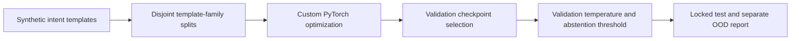

# Semantic Adapters

Pretrained Transformer adaptation, LoRA, limited-label learning, and honest evaluation under template shift.

[](https://github.com/aymaw/semantic-adapters/actions/workflows/ci.yml)


[](LICENSE)

**New personal engineering work, November 2026.** Original, AI-assisted portfolio
implementation with synthetic task data. This is not historical research code,
employer software, or a deployed product. See [provenance](PROVENANCE.md).

## What runs

An explicit PyTorch training loop adapts Hugging Face BERT-Tiny to six synthetic
retail intents: tracking, cancellation, returns, address changes, stock checks,
and product comparison. Compare a frozen backbone plus trained head, PEFT LoRA,
full fine-tuning, and a TF-IDF logistic regression baseline.

The project measures the failure mode where a model memorizes surface forms
without learning robust intent semantics. Held-out negated phrases are especially
difficult. Low training loss is not presented as successful language understanding.


## Reproduce

```bash
# Python 3.11–3.13; uv.lock pins the complete dependency graph.
uv sync --frozen --extra dev
uv run pytest -q
```

Alternatively, `python -m pip install -e '.[dev]'` installs the exact direct
dependencies from `pyproject.toml`, while resolving transitive dependencies.
CPU is the reference execution device. Full runs and checkpoints go to ignored
`runs/`; committed `results/` contains measured reports and provenance only.

```bash
# Downloads public Apache-2.0 Google BERT weights on first run.
uv run python -m semadapt.train
# Label budget experiment, same validation/test examples:
uv run python -m semadapt.train --train-fraction .1 --modes lora full --out runs/low-label
# CI/offline correctness path: RANDOM tiny BERT initialization, not pretrained evidence.
uv run python -m semadapt.train --smoke --epochs 1 --out runs/smoke
```

Pretrained model: `google/bert_uncased_L-2_H-128_A-2`, pinned revision
`30b0a37ccaaa32f332884b96992754e246e48c5f`. The adapter targets attention query
and value projections (rank 8, alpha 16). The classifier is explicitly saved
with the adapter. Every training run reloads its saved checkpoint and verifies
test-logit equivalence within 1e-5. Tests verify frozen base parameters remain
unchanged while adapter and classification-head parameters update.

## Measured reference experiment

CPU; eight epochs; seeds 7, 19, 31; 1,440 train, 360 validation, 1,080 test;
60 separate out-of-domain examples. Template families 0–3 train, 4 validate,
5–7 test. Exact text duplication across partitions is rejected. Checkpoints are
chosen by validation cross entropy. No test-set optimization is performed.

| Method | Trainable parameters | Test macro F1, mean ± seed SD |
|---|---:|---:|
| TF-IDF + logistic regression | n/a | 0.423 |
| head | 774 | 0.320 ± 0.017 |
| lora | 8,966 | 0.204 ± 0.054 |
| full | 4,386,694 | 0.370 ± 0.145 |

The small pretrained model and narrow training template inventory do not yield
strong transfer to unseen phrasing. LoRA is parameter efficient here, but does
not beat the lexical baseline on this benchmark. The 10% label-budget runs are
also retained in [low-label.json](results/low-label.json). They use fewer updates
at a fixed epoch budget and therefore are not compute-matched comparisons.

## Evaluation contract

- Confusion matrices, per-run macro F1 and stratified example-bootstrap intervals.
- Multiclass NLL, Brier score, and ten-bin expected calibration error before and
  after validation-only temperature scaling.
- A validation-only threshold maximizes coverage subject to observed validation
  accuracy ≥95% and at least 30 accepted examples. If no threshold qualifies,
  the system abstains on all examples. This is an empirical selection rule,
  **not** a guarantee of 95% test accuracy or calibrated OOD rejection.
- Separate OOD false-accept rate; OOD texts are not included in the six-class F1.
- Adapter/full/head trainable parameter counts, wall time, full loss histories,
  checkpoint round-trip error, data hash, and upstream revision.

See [raw metrics](results/metrics.json), [error analysis](ERROR_ANALYSIS.md), and
[high-confidence mistakes](results/errors.json). Temperature scaling can worsen
test calibration under distribution shift; both sets of measurements are kept.
The bootstrap resamples examples within labels and does not quantify uncertainty
over unseen template families or domains. The generator is deliberately limited
and cannot establish real-world NLU or deployment readiness.

## Layout and extension points

| Module | Responsibility |
|---|---|
| `data.py` | Generation, family split, deduplication, fingerprint |
| `train.py` | Custom optimization, trainable scopes, serialization and reload |
| `evaluate.py` | Temperature, threshold, bootstrap, calibration and confusion |

Future work should use additional independently authored template families,
human-reviewed ambiguity annotations, stronger encoders, and domain-separated
evaluation. Keep this reported benchmark fixed when comparing a new method.

## References and licenses

- [Google BERT-Tiny model card](https://huggingface.co/google/bert_uncased_L-2_H-128_A-2), Apache-2.0 upstream weights; weights are downloaded at runtime, not redistributed here.
- [Hugging Face PEFT configurations](https://github.com/huggingface/peft/blob/main/docs/source/guides/peft_model_config.md).
- Hu et al., [LoRA](https://arxiv.org/abs/2106.09685).
- Guo et al., [On Calibration of Modern Neural Networks](https://arxiv.org/abs/1706.04599).

Original code and synthetic data: [MIT](LICENSE).
